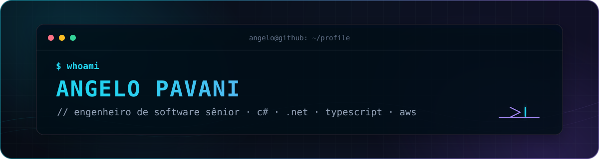

<div align="center">
  

  <br />

  <a href="https://www.linkedin.com/in/angelneto/">
    
  </a>
  <a href="https://gilopavani.github.io/">
    
  </a>
  <a href="mailto:angelopav.98@gmail.com">
    
  </a>
</div>

<br />

```ts
const angelo = {
  role: "Engenheiro de Software Sênior",
  company: "Karsten S.A.",
  location: "Valença, BA · Brasil · Remoto",
  experience: "4+ anos em produção (web, mobile e APIs)",
  mainStack: ["C#", ".NET", "TypeScript", "Node.js", "React", "AWS"],
  alsoWorksWith: ["NestJS", "Next.js", "React Native", "Angular", "Python"],
  mindset: "entender o negócio, desenhar a solução e cuidar dela em produção",
};
```

### `> whoami`

Engenheiro de software com mais de 4 anos construindo **aplicações web, mobile e APIs** que rodam em produção. Hoje estou na **Karsten**, evoluindo o aplicativo e os produtos digitais da empresa com **C# e .NET**. Antes disso, passei por um e-commerce de alto tráfego e por uma consultoria, entregando projetos full stack para clientes de vários segmentos.

- 🏢 Back-end e APIs com **C#/.NET** e **Node.js** (NestJS, Express)
- 🖥️ Front-end e mobile com **React**, **Next.js** e **React Native**
- 🔐 Autenticação, segurança e **API Gateway**
- ☁️ Infraestrutura, deploys e observabilidade na **AWS**
- 🔄 Squads ágeis com **Azure DevOps**, code review e análise estática nos PRs

### `> cat experiencia.log`

| Período | Empresa | O que faço / fiz |
| :--- | :--- | :--- |
| **2026 → hoje** | **Karsten S.A.** · Eng. de Software Sênior | App e produtos digitais em C#/.NET, APIs, integrações, autenticação e API Gateway |
| **2025 → 2026** | **Grupo Goold** · Desenvolvedor de Software | E-commerce de alto tráfego: Next.js, NestJS/Express, React Native (Expo), AWS e observabilidade |
| **2022 → 2025** | **Projectiva** · Desenvolvedor Full Stack | Projetos full stack para clientes diversos com Node.js, React e cloud |
| **2020 → 2023** | **Refil Informática** · Técnico de TI | Manutenção de hardware e infraestrutura de rede — onde tudo começou |

### `> stack --list`

<div align="center">

**Back-end & linguagens**


<br /><br />

**Front-end & mobile**


<br /><br />

**Cloud, dados & ferramentas**


</div>

### `> ls ./projetos-publicos`

| Projeto | O que tem por lá | Stack |
| :--- | :--- | :--- |
| **[Gather Controller](https://github.com/gilopavani/gather-ctl)** | Userscript com painel de controle, inspeção de eventos e automações via WebSocket no Gather.town. | `JavaScript` `WebSocket` `esbuild` |
| **[Portfólio](https://github.com/gilopavani/gilopavani.github.io)** | Meu site pessoal com experiência, stack e projetos. | `Astro` `HTML` `CSS` |
| **[Shopper Test](https://github.com/gilopavani/shopper_test)** | Teste técnico full stack realizado para a Shopper (React + Express + Google Maps API). | `TypeScript` `React` `Express` `Docker` |
| **[LazyVim](https://github.com/gilopavani/lazyvim)** | Meu ambiente de desenvolvimento no Neovim. | `Lua` `Neovim` |

> 💼 A maior parte do meu trabalho é em repositórios privados de empresas e clientes — por isso o gráfico de contribuições inclui atividade privada (anonimizada).

### `> git stats --visual`

<div align="center">
  <picture>
    <source media="(prefers-color-scheme: dark)" srcset="https://streak-stats.demolab.com?user=gilopavani&theme=tokyonight&hide_border=true&locale=pt_BR" />
    
  </picture>
  <br /><br />
  <picture>
    <source media="(prefers-color-scheme: dark)" srcset="https://github-profile-summary-cards.vercel.app/api/cards/profile-details?username=gilopavani&theme=tokyonight" />
    
  </picture>
</div>

<br />

<div align="center">
  <sub><code>while (curious) { build(); learn(); improve(); }</code></sub>
  <br /><br />
  
</div>
